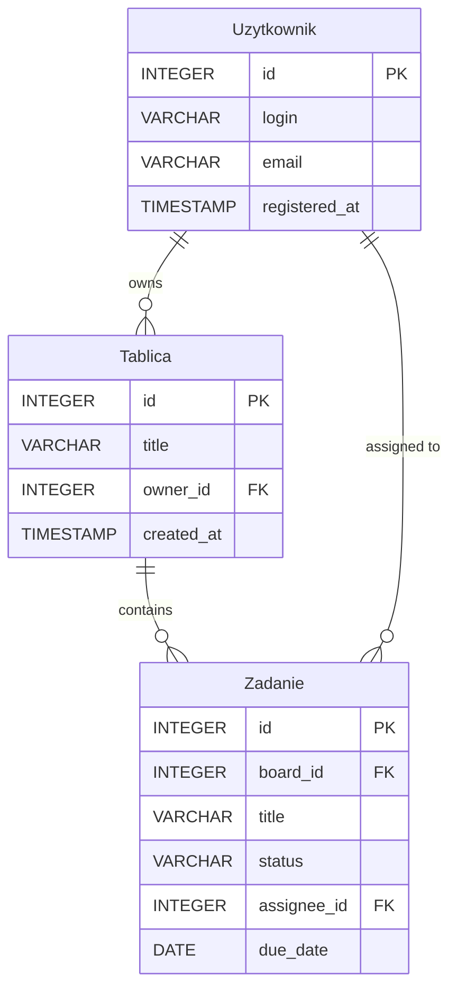

# Opis danych TaskBoard

## Co aplikacja przechowuje

### Użytkownik

| Informacja | Typ | Przykład |
| --- | --- | --- |
| id | INTEGER (PK) | 1 |
| login | VARCHAR(30) | ivan.ivanov |
| email | VARCHAR(100) | ivan.ivanov@example.com |
| registered_at | TIMESTAMP | 2023-09-12 14:22:00 |

### Tablica

| Informacja | Typ | Przykład |
| --- | --- | --- |
| id | INTEGER (PK) | 10 |
| title | VARCHAR(100) | Projekt A |
| owner_id | INTEGER (FK → Użytkownik.id) | 1 |
| created_at | TIMESTAMP | 2023-09-15 09:00:00 |

### Zadanie

| Informacja | Typ | Przykład |
| --- | --- | --- |
| id | INTEGER (PK) | 100 |
| board_id | INTEGER (FK → Tablica.id) | 10 |
| title | VARCHAR(200) | Implement login |
| status | VARCHAR(20) | open |
| assignee_id | INTEGER (FK → Użytkownik.id) | 1 |
| due_date | DATE | 2023-10-01 |

## Powiązania

Każdy Użytkownik może posiadać wiele Tablic, ale każda Tablica ma dokładnie jednego właściciela – pole `owner_id` jest kluczem obcym wskazującym na `Użytkownik.id`. Tablica może zawierać wiele Zadań; kolumna `board_id` w tabeli Zadanie określa, do której tablicy dane zadanie należy. Zadanie może być przypisane jednemu Użytkownikowi przez pole `assignee_id`, dzięki czemu wiemy, kto odpowiada za jego wykonanie.

## Przykład zadania w JSON

```json
{
  "id": 100,
  "title": "Implement login",
  "status": "open",
  "board_id": 10,
  "assignee_id": 1,
  "due_date": "2023-10-01"
}
```

## Wstępny diagram ERD


